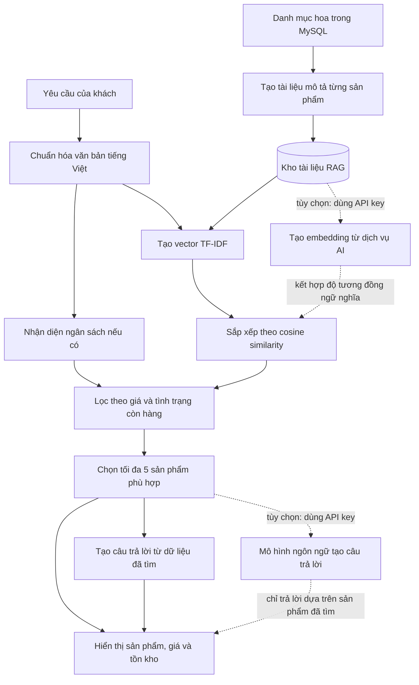

# Kiến trúc hệ thống tư vấn hoa bằng AI

Chatbot tư vấn hoa dựa trên danh mục thật của cửa hàng. Phần tìm kiếm sản phẩm chạy được ngay trên máy, không bắt buộc phải đăng ký dịch vụ AI bên ngoài.

## Các phương pháp và cách hệ thống kiểm soát kết quả

- **TF-IDF:** chấm điểm từ trong câu hỏi và mô tả hoa. Từ xuất hiện nhiều trong một mô tả nhưng ít xuất hiện ở các sản phẩm khác sẽ có trọng số cao hơn.
- **Cosine similarity (độ tương đồng cosine):** so sánh các từ quan trọng trong câu hỏi với từng sản phẩm, rồi xếp sản phẩm phù hợp lên trước.
- **Lọc điều kiện:** nếu khách nêu ngân sách, hệ thống không đưa sản phẩm vượt quá mức đó vào kết quả. Sản phẩm hết hàng cũng bị loại.
- **RAG (tìm thông tin rồi mới trả lời):** chatbot tìm sản phẩm trong danh mục trước, sau đó dùng thông tin sản phẩm tìm được để tạo câu trả lời. Nếu không cấu hình API, câu trả lời được tạo theo mẫu từ dữ liệu thật, không tự bịa sản phẩm.
- **Kết quả dễ kiểm tra:** API trả về cách tìm kiếm đã dùng và số sản phẩm đạt điều kiện để kiểm thử/đánh giá; giao diện chatbot chỉ hiển thị câu tư vấn và sản phẩm.
- **API bên ngoài:** nếu bật dịch vụ AI, khóa API chỉ được dùng ở máy chủ. Hãy lưu khóa trong `.env`; không đưa khóa vào mã giao diện hoặc commit lên kho mã.

## Cách bật Gemini (tùy chọn)

1. Nếu chưa có, sao chép `.env.example` thành `.env`. Không chia sẻ hoặc commit `.env`.
2. Tạo khóa trong [Google AI Studio](https://aistudio.google.com/apikey) và tự nhập vào `AI_API_KEY`. Cấu hình mặc định trong `.env.example` dùng `AI_BASE_URL=https://generativelanguage.googleapis.com/v1beta/openai`, `AI_CHAT_MODEL=gemini-3.1-flash-lite` và `AI_EMBEDDINGS_ENABLED=false`.
3. Chạy `npm run ai:provider-check`. Với cấu hình mặc định, lệnh gửi một yêu cầu chat ngắn; nếu bật embeddings thì lệnh cũng kiểm tra embedding. Request sử dụng hạn mức của nhà cung cấp và lệnh không in API key ra màn hình.
4. Khởi động lại máy chủ API. Không cần tạo embedding hoặc làm mới chỉ mục khi `AI_EMBEDDINGS_ENABLED=false`.
5. Hỏi chatbot một câu mới. Phần truy xuất sản phẩm vẫn chạy TF-IDF/cosine; Gemini tạo câu tư vấn từ những sản phẩm đã truy xuất. Giao diện không hiện nhãn phương pháp.

Dự án không kèm khóa API. Việc gọi Gemini cần khóa riêng của người dùng và chịu hạn mức/điều khoản hiện hành của Google. Bộ đánh giá hiện tại chỉ đo phương pháp TF-IDF chạy nội bộ; nó chưa đánh giá chất lượng câu trả lời do Gemini tạo.
